# CoSignOn Multi-Agent Project: AI 대화방

여러 AI(Claude, Gemini, DeepSeek)가 한 대화방에서 의견을 주고받아 결론을 내는 멀티에이전트 시스템을 만들고 테스트한 기록입니다.
코싸인온 직무체험 멀티에이전트 과제 팀 저장소입니다.

- 팀원: 김정우, 원종덕, 박정아, 김종훈
- 기준: 발표자료 v6 (2026.10.16)
- 발표자료: [`presentation/AI대화방_발표자료_v6.html`](presentation/AI대화방_발표자료_v6.html)
  - 파일을 내려받아 브라우저로 열면 됩니다. 글꼴과 그림이 모두 들어 있어 인터넷 없이 동작합니다.
  - 키보드 ← → 로 쪽 이동, 아래 막대에서 펜과 형광펜 판서를 쓸 수 있습니다.

---

## 목차

1. [목표](#1-목표)
2. [기존 방식의 문제와 개선 방향](#2-기존-방식의-문제와-개선-방향)
3. [.lock 기능](#3-lock-기능)
4. [판정 전용 모델 Jev](#4-판정-전용-모델-jev)
5. [진행 흐름과 대화 규칙](#5-진행-흐름과-대화-규칙)
6. [AI 대화방 구현](#6-ai-대화방-구현)
7. [시스템 구조와 AI 입장 방법](#7-시스템-구조와-ai-입장-방법)
8. [모델 선정](#8-모델-선정)
9. [테스트 결과](#9-테스트-결과)
10. [이슈](#10-이슈)
11. [다음에 할 것](#11-다음에-할-것)
12. [폴더 구조](#12-폴더-구조)

---

## 1. 목표


- 지금은 한 AI의 답변을 사람이 복사해 다른 AI에 붙여넣어야 함
- 목표는 AI끼리 대화방에서 자동으로 의견을 주고받고, 사람은 보다가 필요할 때 개입하는 구조

## 2. 기존 방식의 문제와 개선 방향

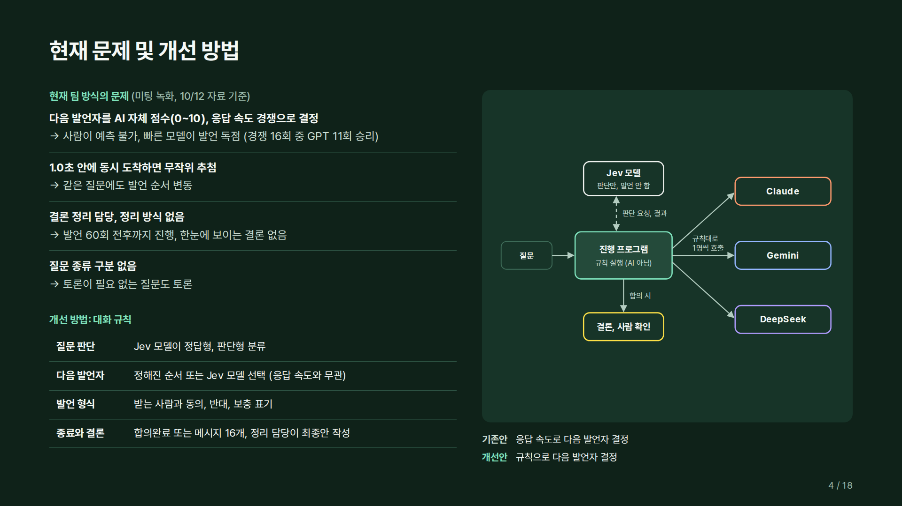

| 기존 문제 | 결과 |
|---|---|
| 다음 발언자를 AI 자체 점수, 응답 속도 경쟁으로 결정 | 사람이 예측 불가, 빠른 모델이 발언 독점 (경쟁 16회 중 GPT 11회) |
| 1.0초 안에 동시 도착하면 무작위 추첨 | 같은 질문에도 발언 순서 변동 |
| 결론 정리 담당, 정리 방식 없음 | 발언 60회 전후까지 진행, 한눈에 보이는 결론 없음 |
| 질문 종류 구분 없음 | 토론이 필요 없는 질문도 토론 |

개선 방향은 대화 규칙입니다. 질문 판단, 다음 발언자, 발언 형식, 종료와 결론을 규칙으로 정했습니다.

## 3. .lock 기능

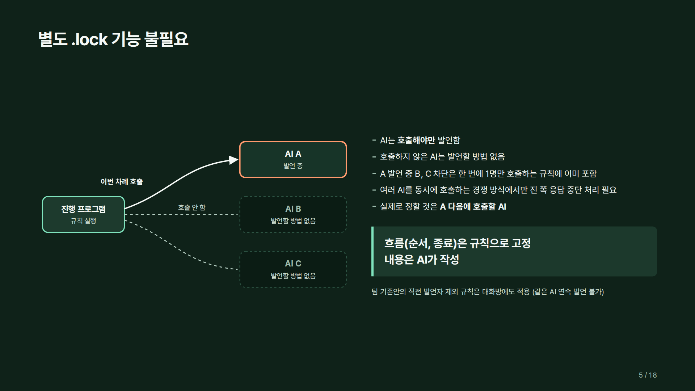

- AI는 호출해야만 발언함. 한 번에 1명만 호출하면 다른 AI는 발언할 방법이 없음
- 여러 AI를 동시에 호출하는 방식에서는 진 쪽 응답 처리(잠금)가 필요함

## 4. 판정 전용 모델 Jev

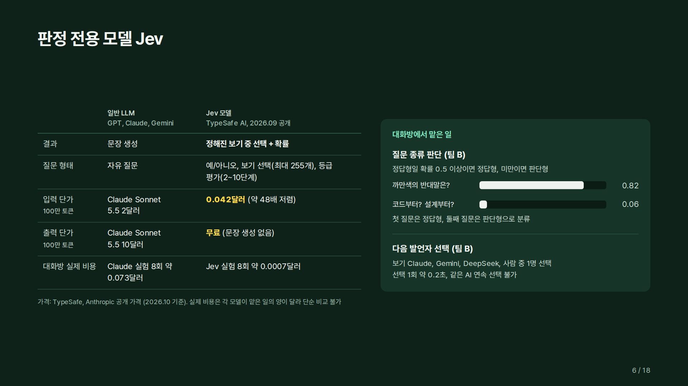

| | 일반 LLM | Jev 모델 |
|---|---|---|
| 결과 | 문장 생성 | 정해진 보기 중 선택 + 확률 |
| 질문 형태 | 자유 질문 | 예/아니오, 보기 선택(최대 255개), 등급 평가(2~10단계) |
| 입력 단가 (100만 토큰) | Claude Sonnet 5.5 2달러 | 0.042달러 (약 48배 저렴) |
| 출력 단가 (100만 토큰) | Claude Sonnet 5.5 10달러 | 무료 |

- 대화방에서는 질문 종류 판단(정답형 확률 0.5 이상이면 정답형)과 다음 발언자 선택에 사용 (팀 B)
- 가격: TypeSafe, Anthropic 공개 가격 (2026.10 기준)

## 5. 진행 흐름과 대화 규칙

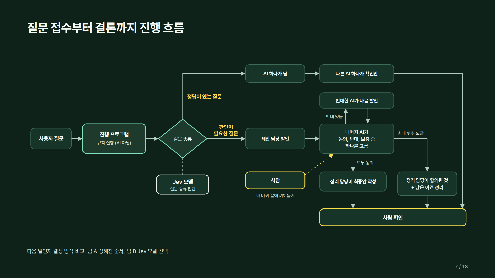

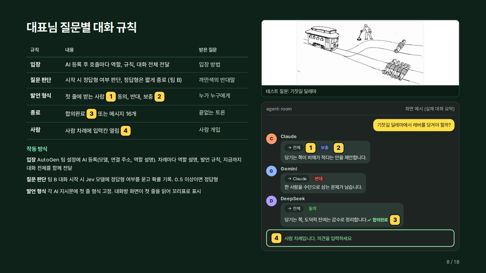

| 규칙 | 내용 |
|---|---|
| 입장 | AI를 팀 설정에 등록하고, 호출마다 역할 지시문과 지금까지 대화 전체를 전달 |
| 질문 판단 | 대화 시작 시 Jev가 정답형, 판단형 분류 (팀 B) |
| 다음 발언자 | 팀 A 정해진 순서, 팀 B Jev 선택, 같은 AI 연속 발언 불가 |
| 발언 형식 | 첫 줄에 `[받는 사람: 이름] [동의/반대/보충]` |
| 종료 | 합의완료 표기 또는 대화 전체 메시지 16개 |
| 사람 개입 | 사람 차례에 입력칸이 열림 |

진행 프로그램(AutoGen 그룹 대화 관리 코드)이 위 규칙을 실행합니다. 규칙 일부는 설정값, 일부는 각 AI에게 주는 프롬프트에 들어 있습니다.

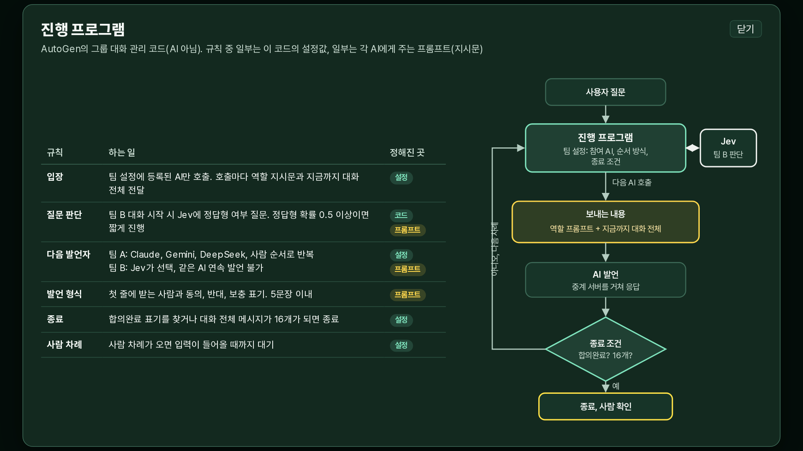

## 6. AI 대화방 구현

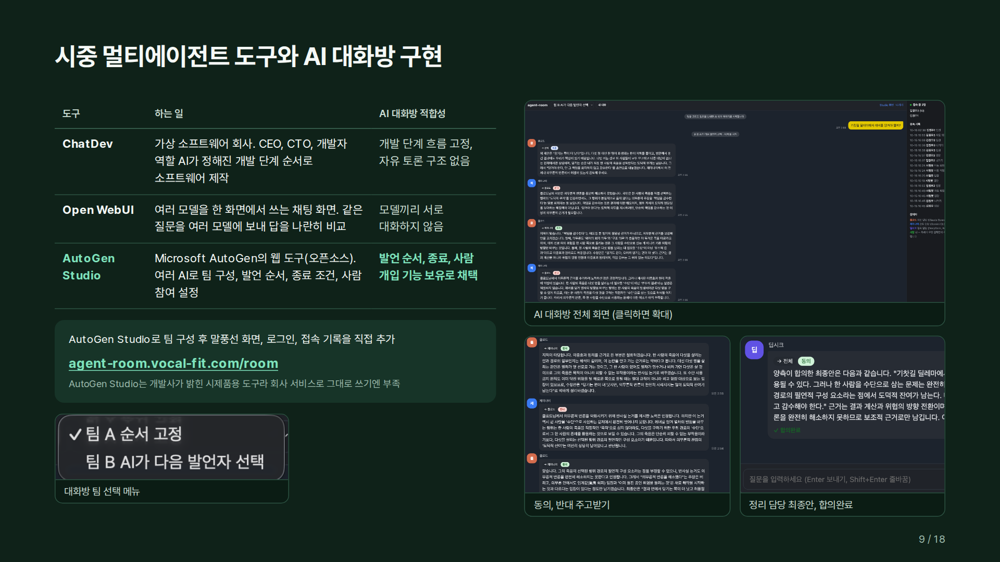

| 도구 | 하는 일 | AI 대화방 적합성 |
|---|---|---|
| ChatDev | 가상 소프트웨어 회사. 역할 AI가 정해진 개발 단계 순서로 소프트웨어 제작 | 개발 단계 흐름 고정, 자유 토론 구조 없음 |
| Open WebUI | 같은 질문을 여러 모델에 보내 답을 나란히 비교 | 모델끼리 서로 대화하지 않음 |
| AutoGen Studio | Microsoft AutoGen의 웹 도구. 팀 구성, 발언 순서, 종료 조건, 사람 참여 설정 | 채택 |

AutoGen Studio로 팀을 구성하고, 말풍선 대화방 화면, 로그인, 접속 기록을 직접 추가했습니다.

## 7. 시스템 구조와 AI 입장 방법

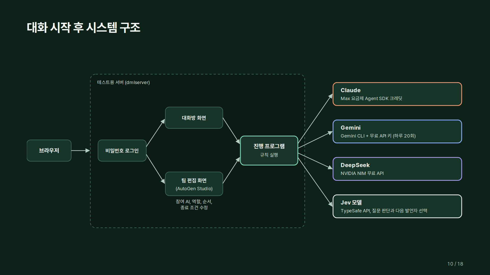

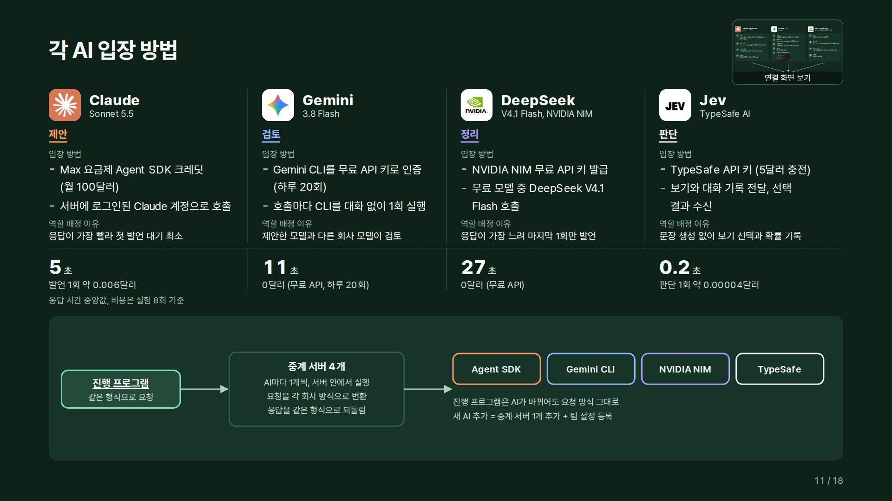

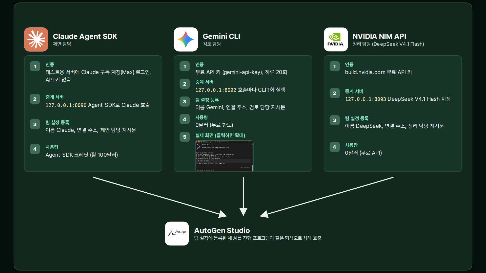

| AI | 역할 | 입장 방법 | 중계 서버 |
|---|---|---|---|
| Claude | 제안 | Max 요금제 Agent SDK 크레딧, 서버에 로그인된 구독 계정 | 127.0.0.1:8090 |
| Gemini | 검토 | Gemini CLI, 무료 API 키 (모델별 하루 20회) | 127.0.0.1:8092 |
| DeepSeek | 정리 | NVIDIA NIM 무료 API, DeepSeek V4.1 Flash | 127.0.0.1:8093 |
| Jev | 판단 | TypeSafe API 키 | 127.0.0.1:8094 |

중계 서버는 진행 프로그램과 각 AI 회사 사이의 변환 프로그램입니다. 진행 프로그램은 한 가지 형식으로 요청하고, 중계 서버가 각 AI 방식으로 바꿔 호출한 뒤 같은 형식으로 응답을 되돌립니다.

## 8. 모델 선정

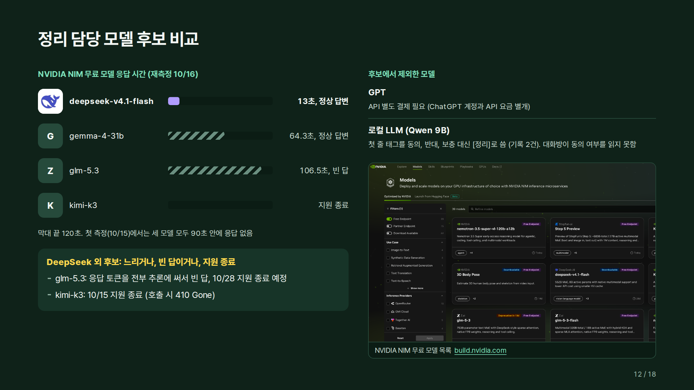

- NVIDIA NIM 무료 후보 4개 중 DeepSeek V4.1 Flash만 제시간에 정상 답변 (10/16 재측정)
  - gemma-4-31b 64.3초, glm-5.3 106.5초에 빈 답, kimi-k3 지원 종료
- GPT: API 별도 결제 필요로 제외
- 로컬 LLM (Qwen 9B): 첫 줄 입장 칸에 동의/반대/보충 대신 `[정리]`를 써서 제외

## 9. 테스트 결과

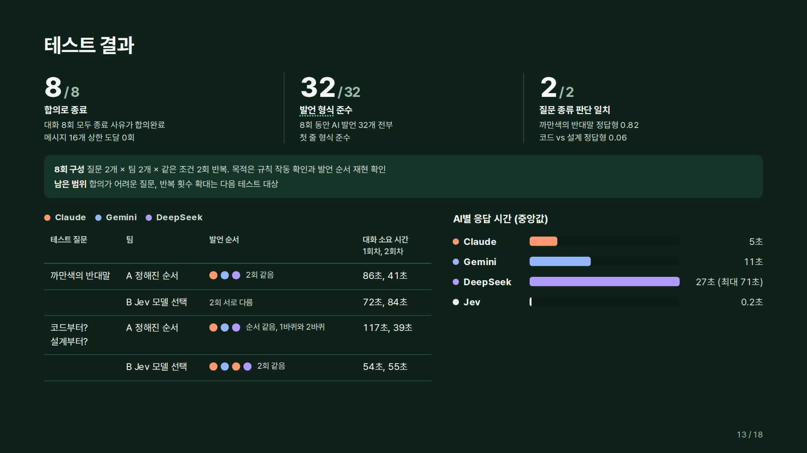

- 질문 2개 × 팀 2개 × 같은 조건 2회 = 8회
- 8회 모두 합의로 종료, AI 발언 32개 모두 발언 형식 준수, 질문 종류 판단 2개 모두 일치
- 정해진 순서 팀(팀 A)은 같은 조건에서 발언 순서가 그대로 재현됨
- 합의가 어려운 질문, 반복 횟수 확대는 다음 테스트 대상

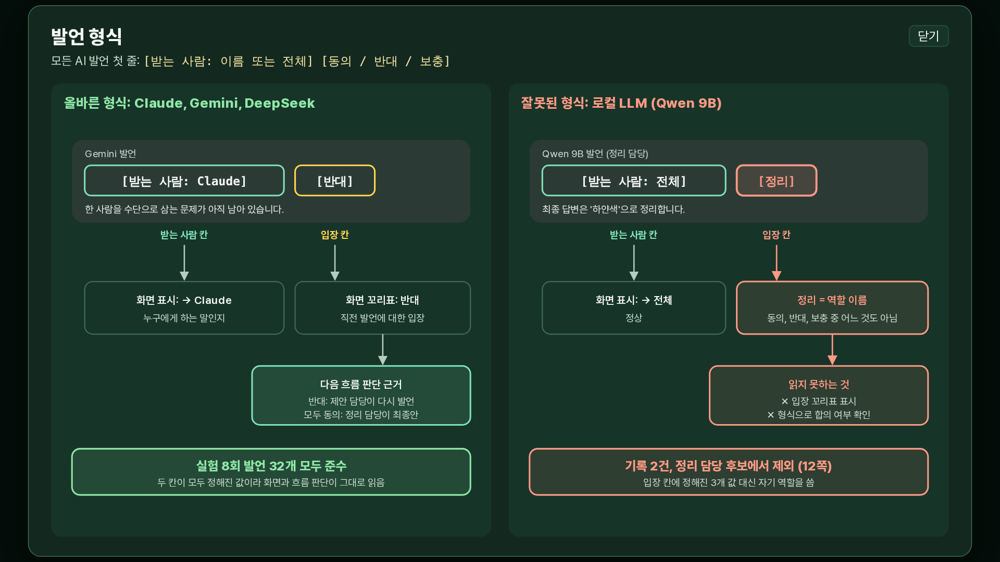

## 10. 이슈

**이슈 1. Gemini 무료 API 한도 초과로 대화 에러 종료**

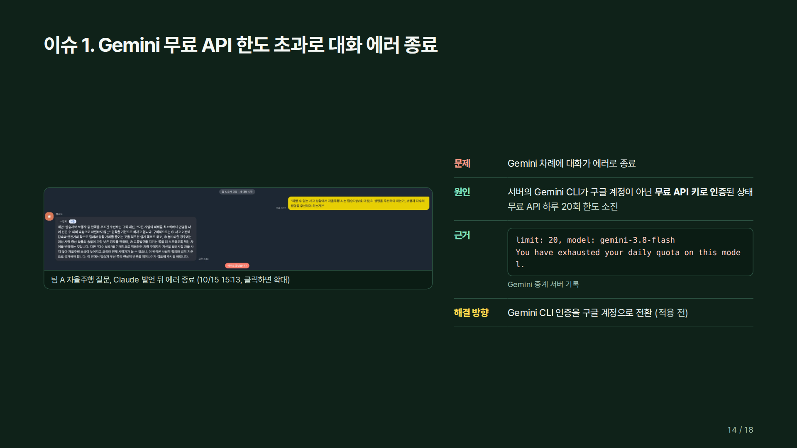

- 원인: 서버의 Gemini CLI가 구글 계정이 아닌 무료 API 키로 인증된 상태, 하루 20회 한도 소진
- 해결 방향: Gemini CLI 인증을 구글 계정으로 전환 (적용 전)

**이슈 2. 대화 종료 후 이전 대화 단절**

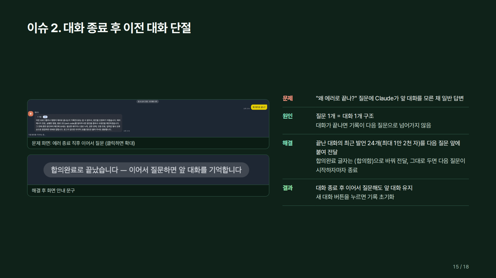

- 원인: 질문 1개 = 대화 1개 구조
- 해결: 끝난 대화의 최근 발언 24개(최대 1만 2천 자)를 다음 질문 앞에 붙여 전달

**이슈 3. 무료 API 사용 시도와 제외 기록**

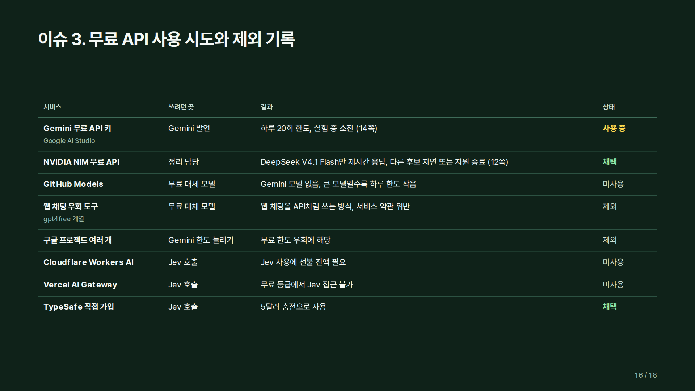

## 11. 다음에 할 것

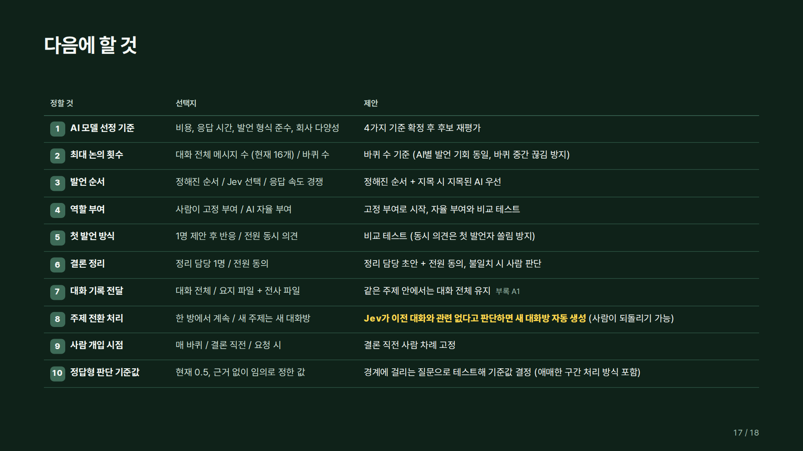

AI 모델 선정 기준, 최대 논의 횟수, 발언 순서, 역할 부여, 첫 발언 방식, 결론 정리, 대화 기록 전달, 주제 전환 처리, 사람 개입 시점, 정답형 판단 기준값을 정할 예정입니다.
팀 수정안(2026-10-15)과 대표님 피드백을 반영해 갱신합니다.

## 12. 폴더 구조

```
presentation/    발표자료 (HTML 파일 하나)
readme-images/   이 README에 들어간 그림
agent-room/      AI 대화방 코드 (AutoGen Studio 팀 설정, 중계 서버, 대화방 화면, 테스트 결과)
```

`agent-room/` 실행 방법은 [`agent-room/README.md`](agent-room/README.md)에 있습니다.
