# CoSignOn Multi-Agent Project: AI 대화방

여러 AI가 한 대화방에서 의견을 주고받아 결론을 내는 멀티에이전트 시스템을 만들고 테스트하는 팀 저장소입니다.

- 팀원: 김정우, 원종덕, 박정아, 김종훈
- 기준: 발표자료 v9 (2026.10.16)
- 발표자료: [`presentation/AI대화방_발표자료_v9.html`](presentation/AI대화방_발표자료_v9.html)
  - 파일을 내려받아 브라우저로 열면 됩니다. 글꼴과 그림이 모두 들어 있어 인터넷 없이 동작합니다.
  - 키보드 ← → 로 쪽 이동, 아래 막대에서 펜과 형광펜 판서, "부록 A6" 같은 글자를 누르면 그 쪽으로 이동합니다.

## 폴더 구조

```
presentation/    발표자료 (HTML 파일 하나)
readme-images/   이 README에 들어간 그림
agent-room/      AutoGen 기반 웹 대화방 (김정우): 대화방 화면, 승인 로그인, 중계 서버, 팀 설정, 테스트 결과
cli-engine/      팀 수정안 v2 실험 엔진 (원종덕, 박정아): feature/cli-engine 브랜치
```

각 폴더의 실행 방법은 [`agent-room/README.md`](agent-room/README.md), `cli-engine/README.md`에 있습니다.

---

## 목차

1. [목표](#1-목표)
2. [기존 두 시스템의 공통 구조](#2-기존-두-시스템의-공통-구조)
3. [대표님 피드백과 기존 구조의 차이](#3-대표님-피드백과-기존-구조의-차이)
4. [개선 알고리즘: 팀 수정안 v2와 엔진](#4-개선-알고리즘-팀-수정안-v2와-엔진)
5. [메시지 흐름 단계별 그림](#5-메시지-흐름-단계별-그림)
6. [.lock 필요 여부](#6-lock-필요-여부)
7. [두 작업의 보완점](#7-두-작업의-보완점)
8. [기존 구조 테스트 결과](#8-기존-구조-테스트-결과)
9. [다음에 할 것](#9-다음에-할-것)
10. [부록: Jev, 웹 대화방, 입장 방법, 이슈](#10-부록)

---

## 1. 목표

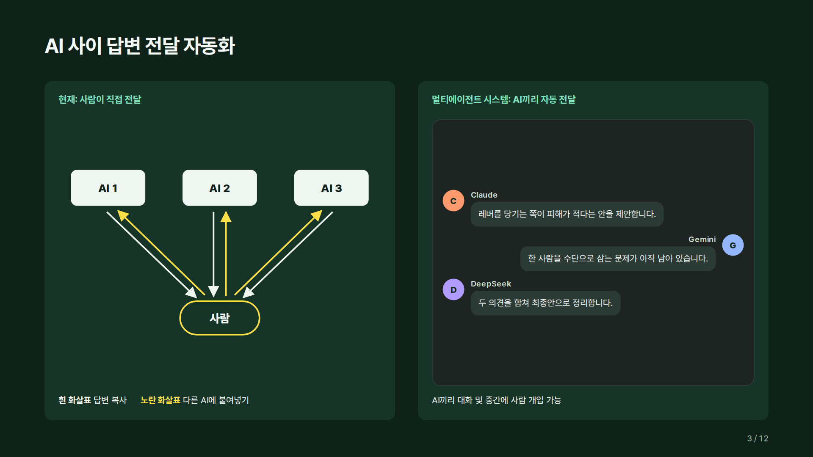

- 지금은 한 AI의 답변을 사람이 복사해 다른 AI에 붙여넣어야 함
- 목표는 AI끼리 대화방에서 자동으로 의견을 주고받고, 사람은 보다가 필요할 때 개입하는 구조

## 2. 기존 두 시스템의 공통 구조

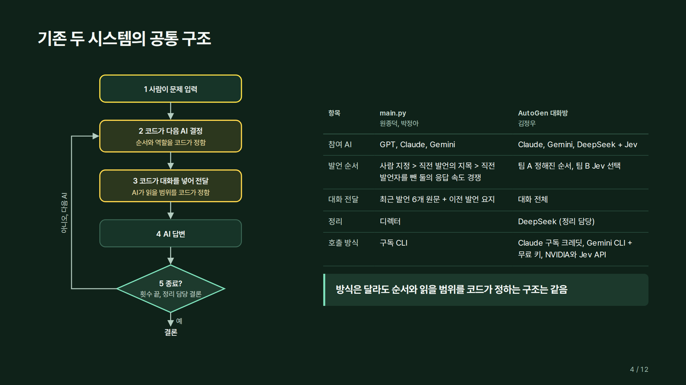

| 항목 | main.py (원종덕, 박정아) | AutoGen 대화방 (김정우) |
|---|---|---|
| 참여 AI | GPT, Claude, Gemini | Claude, Gemini, DeepSeek + Jev |
| 발언 순서 | 사람 지정 > 직전 발언의 지목 > 직전 발언자를 뺀 둘의 응답 속도 경쟁 | 팀 A 정해진 순서, 팀 B Jev 선택 |
| 대화 전달 | 최근 발언 6개 원문 + 이전 발언 요지 | 대화 전체 |
| 정리 | 디렉터 | DeepSeek (정리 담당) |
| 호출 방식 | 구독 CLI | Claude 구독 크레딧, Gemini CLI + 무료 키, NVIDIA와 Jev API |

방식은 달라도 순서와 읽을 범위를 코드가 정하는 구조는 같습니다.

## 3. 대표님 피드백과 기존 구조의 차이

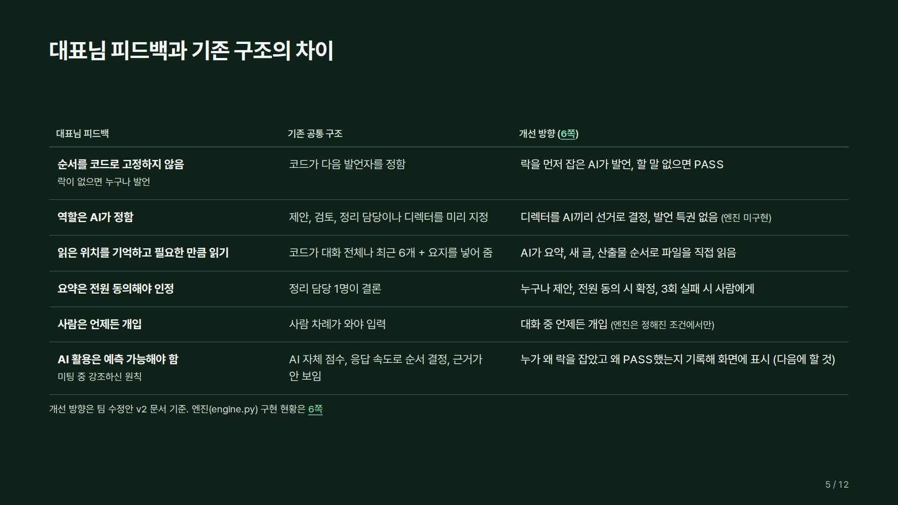

| 대표님 피드백 | 기존 공통 구조 | 개선 방향 |
|---|---|---|
| 순서를 코드로 고정하지 않음 | 코드가 다음 발언자를 정함 | 먼저 생각을 끝낸 AI가 잠금 안에서 발언, 할 말 없으면 PASS |
| 역할은 AI가 정함 | 역할이나 디렉터를 미리 지정 | 디렉터를 AI끼리 선거로 결정 (엔진 미구현, 다음에 할 것) |
| 읽은 위치를 기억하고 필요한 만큼 읽기 | 코드가 대화를 넣어 줌 | AI가 요약, 새 글, 산출물 순서로 파일을 직접 읽음 |
| 요약은 전원 동의해야 인정 | 정리 담당 1명이 결론 | 누구나 제안, 전원 동의 시 확정 |
| 사람은 언제든 개입 | 사람 차례가 와야 입력 | 언제든 개입 (엔진은 정해진 조건에서만) |
| AI 활용은 예측 가능해야 함 | 순서 결정 근거가 안 보임 | 누가 왜 발언했고 왜 PASS했는지 기록 |

## 4. 개선 알고리즘: 팀 수정안 v2와 엔진

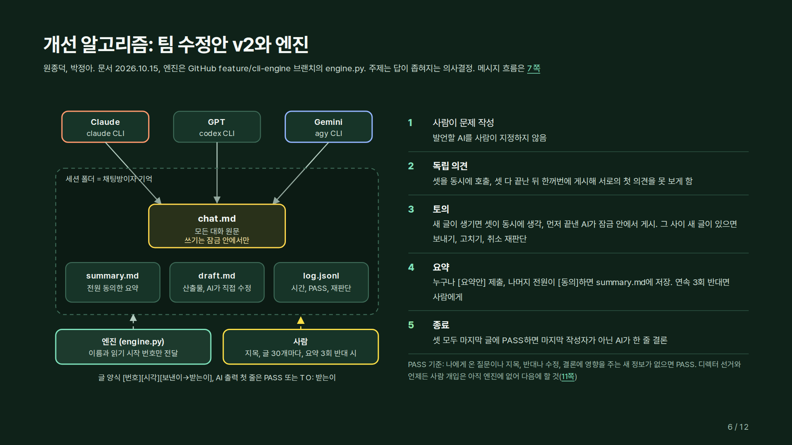

- 세션 폴더 하나가 채팅방이자 기억: `chat.md`(대화 원문), `summary.md`(전원 동의한 요약), `draft.md`(산출물), `log.jsonl`(호출 기록)
- 엔진은 AI에게 이름과 읽기 시작 번호만 전달하고, AI가 파일을 직접 읽고 씀
- 진행: 문제 작성(발언할 AI는 사람이 지정하지 않음) → 독립 의견(셋 동시, 서로 못 보게) → 토의(새 글이 생기면 셋이 동시에 생각, 먼저 끝낸 AI가 게시, 늦은 AI는 보내기/고치기/취소 재판단) → 요약(전원 동의 시 저장, 연속 3회 반대면 사람에게) → 종료(전원 PASS, 한 줄 결론)
- 사람은 AI가 지목할 때, 글 30개마다, 요약 3회 반대 시 개입 (30개와 3회는 임시값)
- 디렉터 선거와 언제든 개입은 아직 엔진에 없어 다음에 할 것으로 넘김

## 5. 메시지 흐름 단계별 그림

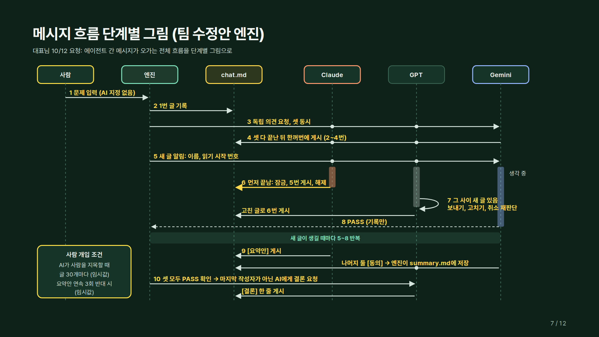

- 1~4: 시작할 때 한 번 (문제 입력, 기록, 독립 의견 요청, 한꺼번에 게시)
- 5~8: 새 글이 생길 때마다 반복 (알림, 셋이 동시에 생각, 먼저 끝낸 AI가 잠금 안에서 게시, 늦은 AI는 재판단 또는 PASS)
- 9: 요약안에 나머지 전원이 동의하면 summary.md에 저장
- 10: 셋 모두 PASS하면 마지막 작성자가 아닌 AI가 한 줄 결론

## 6. .lock 필요 여부

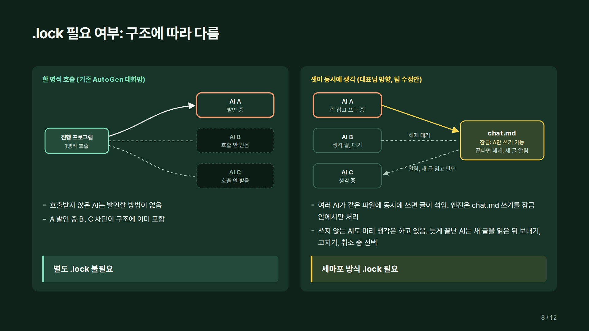

- 한 명씩 호출하는 구조(기존 AutoGen 대화방): 호출받지 않은 AI는 발언할 방법이 없어 별도 잠금 불필요
- 셋이 동시에 생각하는 구조(팀 수정안): 같은 파일에 동시에 쓰면 글이 섞이므로 쓰기 잠금 필요

## 7. 두 작업의 보완점

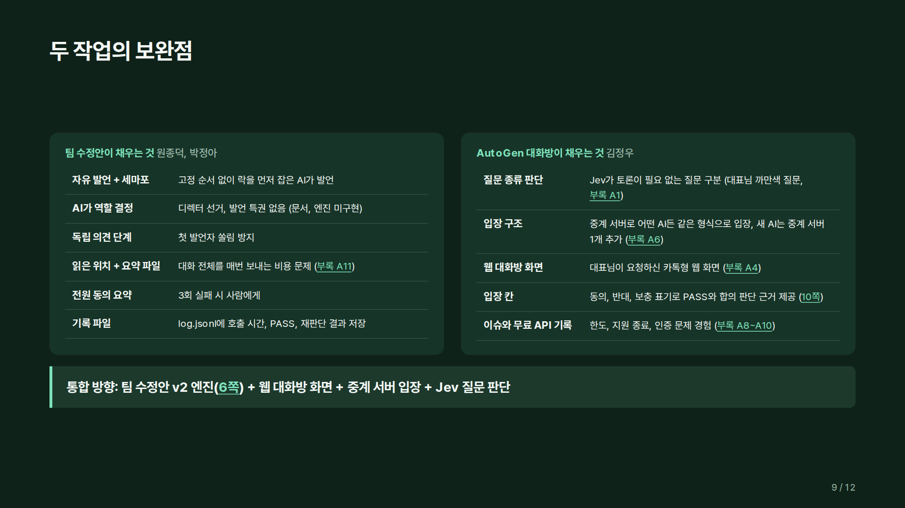

통합 방향: 팀 수정안 v2 엔진 + 웹 대화방 화면 + 중계 서버 입장 + Jev 질문 판단

## 8. 기존 구조 테스트 결과

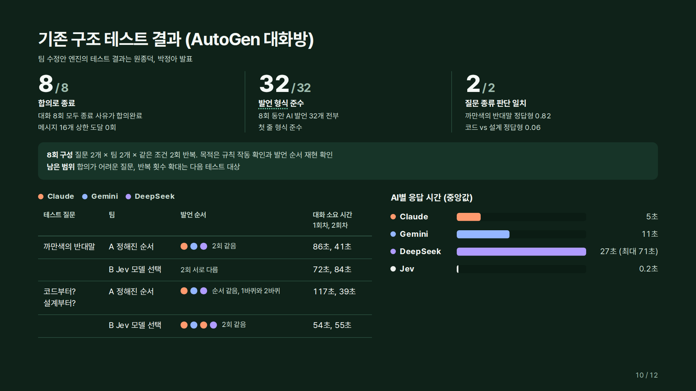

- AutoGen 대화방에서 질문 2개 × 팀 2개 × 같은 조건 2회 = 8회
- 8회 모두 합의로 종료, AI 발언 32개 모두 발언 형식 준수, 질문 종류 판단 2개 모두 일치
- 정해진 순서 팀은 같은 조건에서 발언 순서가 그대로 재현됨

## 9. 다음에 할 것

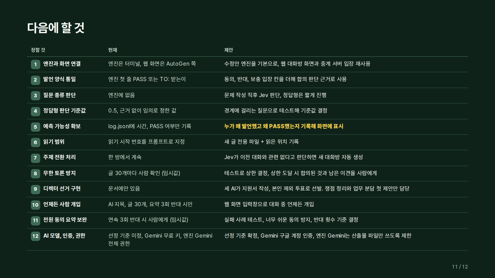

| 번호 | 정할 것 | 제안 |
|---|---|---|
| 1 | 엔진과 화면 연결 | 수정안 엔진을 기본으로, 웹 대화방 화면과 중계 서버 입장 재사용 |
| 2 | 발언 양식 통일 | 동의, 반대, 보충 입장 칸 추가 |
| 3 | 질문 종류 판단 | 문제 작성 직후 Jev 판단, 정답형은 짧게 |
| 4 | 정답형 판단 기준값 | 현재 0.5(임의), 경계 질문 테스트로 결정 |
| 5 | 예측 가능성 확보 | 누가 왜 발언했고 왜 PASS했는지 기록해 화면에 표시 |
| 6 | 읽기 범위 | 새 글 전용 파일 + 읽은 위치 기록 |
| 7 | 주제 전환 처리 | Jev가 새 주제로 판단하면 새 대화방 |
| 8 | 무한 토론 방지 | 글 30개(임시값) 대신 테스트로 상한 결정 |
| 9 | 디렉터 선거 구현 | 지원서 작성, 본인 제외 투표로 선발. 쟁점 정리와 업무 분담 첫 제안만 담당 |
| 10 | 언제든 사람 개입 | 웹 화면 입력창으로 대화 중 언제든 개입 |
| 11 | 전원 동의 요약 보완 | 실패 사례 테스트, 너무 쉬운 동의 방지, 반대 횟수 기준 결정 |
| 12 | AI 모델, 인증, 권한 | 선정 기준 확정, Gemini 구글 계정 인증, 엔진 Gemini는 산출물 파일만 쓰도록 제한 |

## 10. 부록

**Jev (판정 전용 모델)**

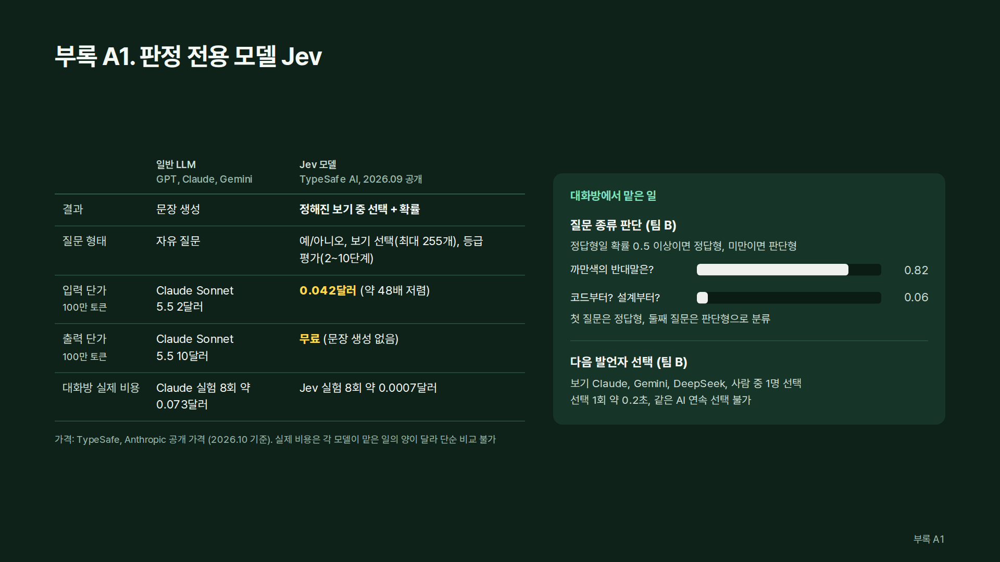

**기존 AutoGen 대화방 진행 흐름**

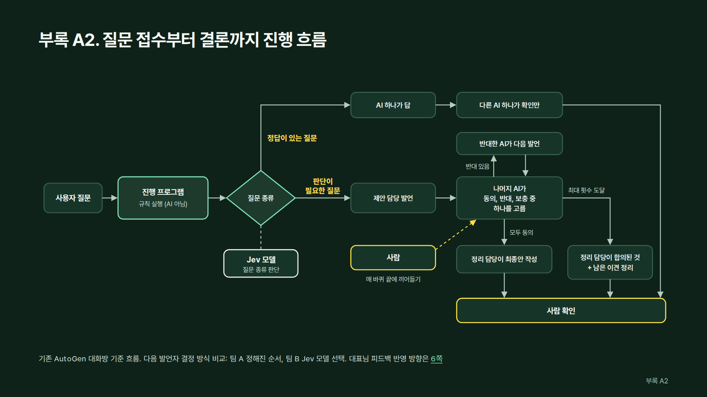

**웹 대화방과 시중 도구 비교**


**시스템 구조와 AI 입장 방법**

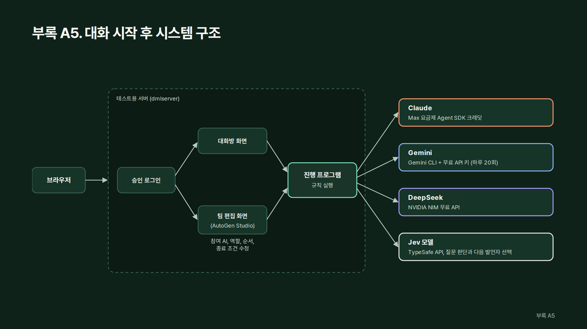

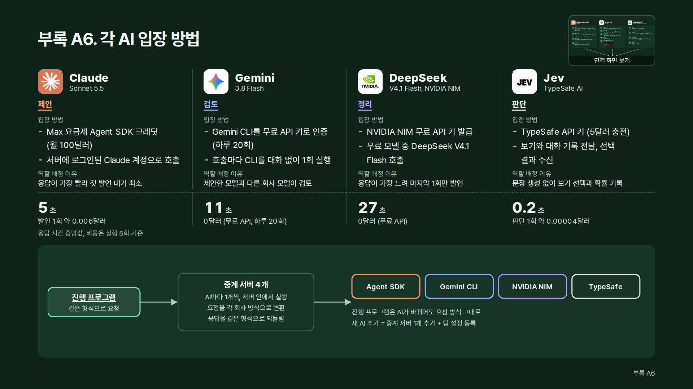


중계 서버는 진행 프로그램과 각 AI 회사 사이의 변환 프로그램입니다. 진행 프로그램은 한 가지 형식으로 요청하고, 중계 서버가 각 AI 방식으로 바꿔 호출한 뒤 같은 형식으로 응답을 되돌립니다.

**모델 후보 비교**

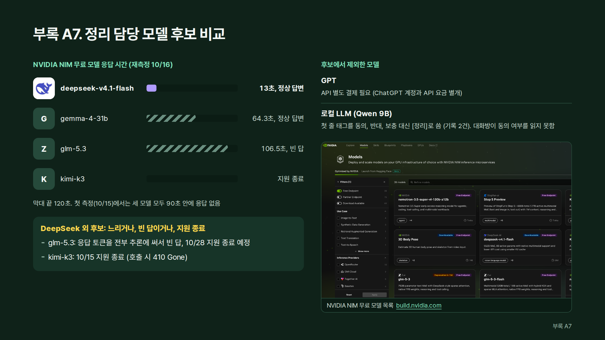

**이슈**

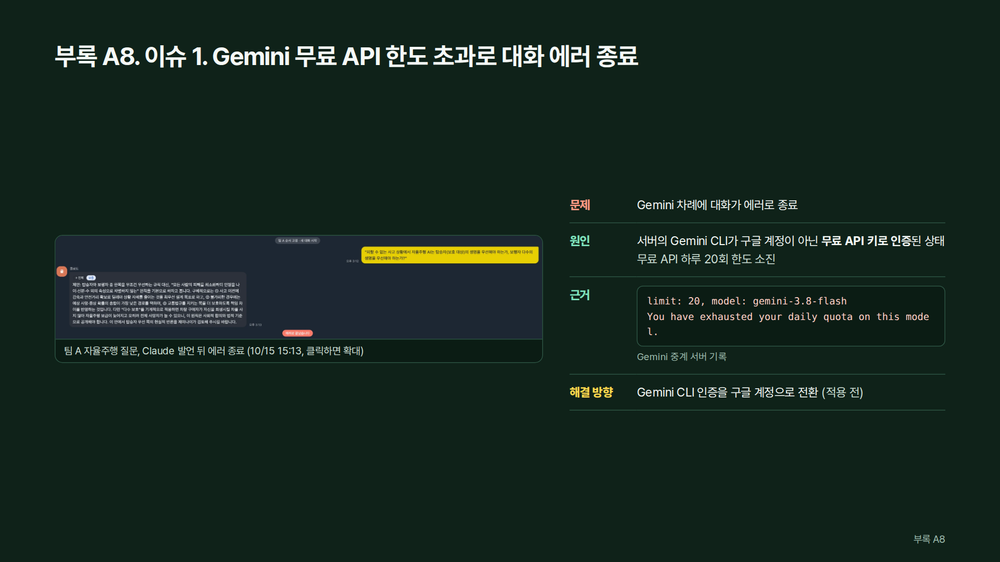

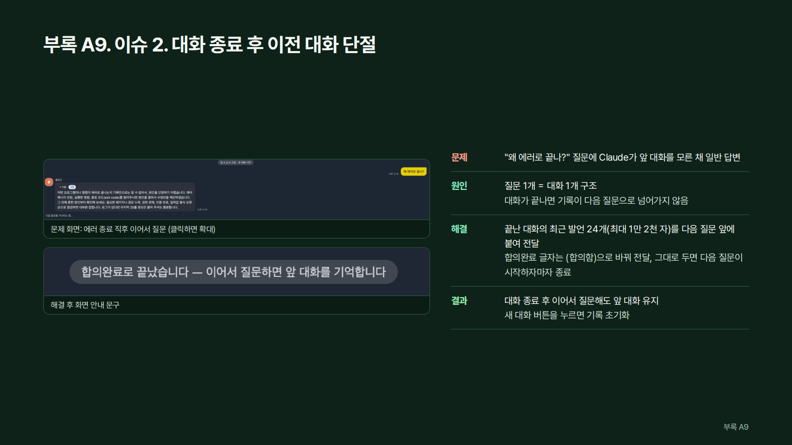

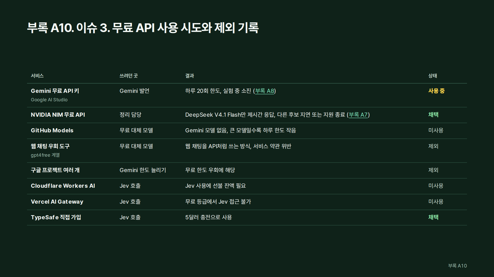

## 웹 대화방 접속

대화방은 관리자 승인 방식입니다. 처음 접속하면 이름을 입력해 승인을 요청하고, 화면에 뜬 6자리 코드를 김정우에게 알려 주세요. 승인되면 그 브라우저로 30일 동안 들어올 수 있습니다.
